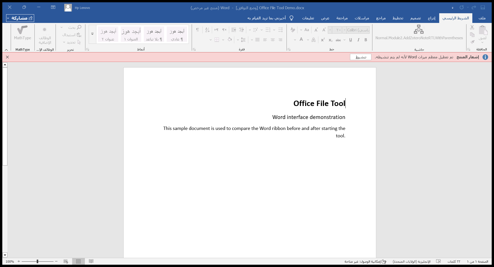
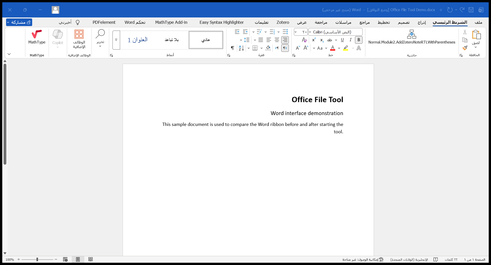

# Office File Tool 1.3.4

أداة Python لنظام Windows بواجهة رسومية لاختيار ملفات Office وفتحها، مع التكامل مع قائمة «فتح باستخدام» وإدارة جلسات التشغيل والاستعادة وإعدادات تحديث Office.

وضع التجربة مرتبط بإصدار Office **16.0.19628.20132 بمعمارية 32-bit (x86)**. تتحقق الأداة من بصمات الملفات قبل تطبيق التعديلات المؤقتة في ذاكرة الجلسة. احفظ مستنداتك قبل بدء جلسة أو استعادتها. يتطلب استخدام Office حسابًا أو ترخيصًا مناسبًا.

## تحميل التطبيق الجاهز

[تحميل OfficeFileTool.exe — الإصدار 1.3.4](https://github.com/futh2/OfficeFileTool/releases/download/v1.3.4/OfficeFileTool.exe)

نسخة مستقلة لنظام Windows x64، لا تحتاج إلى تثبيت Python. حمّل الملف وشغّله مباشرة. يتطلب وضع التجربة إصدار Office المطابق المذكور أعلاه.

[صفحة الإصدار وملف التحقق SHA256](https://github.com/futh2/OfficeFileTool/releases/tag/v1.3.4)

## صور Word قبل تشغيل الأداة وبعده

لقطتان فعليتان لنفس المستند التجريبي على Office 16.0.19628.20132 ‏32-bit.

### قبل — أوامر التحرير معطّلة

يظهر شريط الأدوات بالرمادي مع إشعار Word بتعطيل معظم الميزات لعدم تنشيط المنتج.



### بعد — أوامر التحرير متاحة في جلسة الأداة

تظهر أوامر الخط والفقرة والأنماط مفعّلة في شريط Word بعد فتح المستند من الأداة.



المقارنة توثّق حالة واجهة التحرير في هذه الجلسة؛ يبقى Word يعرض «منتج غير مرخص»، ويبقى Copilot غير مفعّل. لا تعني الصور تنشيط ترخيص Office أو إتاحة جميع الخدمات المتصلة.

## التشغيل من المصدر

المتطلبات: Windows، وPython 3.9 أو أحدث، ونسخة Office المطابقة لوضع التجربة. تستخدم الواجهة Tkinter المرفق عادةً مع مثبت Python لنظام Windows.

```powershell
python -m venv .venv
.\.venv\Scripts\python.exe -m pip install -r requirements.txt
.\.venv\Scripts\python.exe source\office_tool.py
```

لفتح ملف مباشرة:

```powershell
.\.venv\Scripts\python.exe source\office_tool.py "C:\Documents\example.docx"
```

تشغيل الأداة دون ملف يعرض واجهتها. يدعم التعرف على امتدادات Word وPowerPoint وExcel وAccess وPublisher وOneNote وOutlook؛ يقتصر OneNote وOutlook على التشغيل العادي.

## الاختبارات

```powershell
.\.venv\Scripts\python.exe -m unittest discover -s source -p test_office_tool.py -v
```

## بناء ملف EXE مستقل

من بيئة Python مفعلة وبها متطلبات البناء:

```powershell
python -m pip install -r requirements-build.txt
powershell -ExecutionPolicy Bypass -File source\build.ps1
```

ينصب سكربت البناء متطلباته، ويشغّل الاختبارات ثم ينشئ `OfficeFileTool.exe` في جذر المشروع. الملف التنفيذي ومخرجات البناء مستثناة من Git.

## ملفات المشروع

- `source/office_tool.py`: الأداة الحالية.
- `source/test_office_tool.py`: الاختبارات.
- `source/build.ps1`: بناء النسخة المستقلة بواسطة PyInstaller.
- `Office-16.0.19628.20132-32bit.xml`: إعداد Office Deployment Tool للإصدار المطابق.
- [دليل الاستخدام والتثبيت](دليل%20الاستخدام%20والتثبيت.md): تفاصيل التشغيل والتوافق وسجل الإصدار المحلي؛ إشاراته إلى EXE وصور التحقق تخص الحزمة المحلية الأصلية.

يتطلب تغيير سياسة التحديثات صلاحية مسؤول Windows. قد تختلف نتائج ميزات Office المتصلة باختلاف الحساب والخدمة؛ إظهار زر في الواجهة لا يثبت تفعيل الخدمة.
